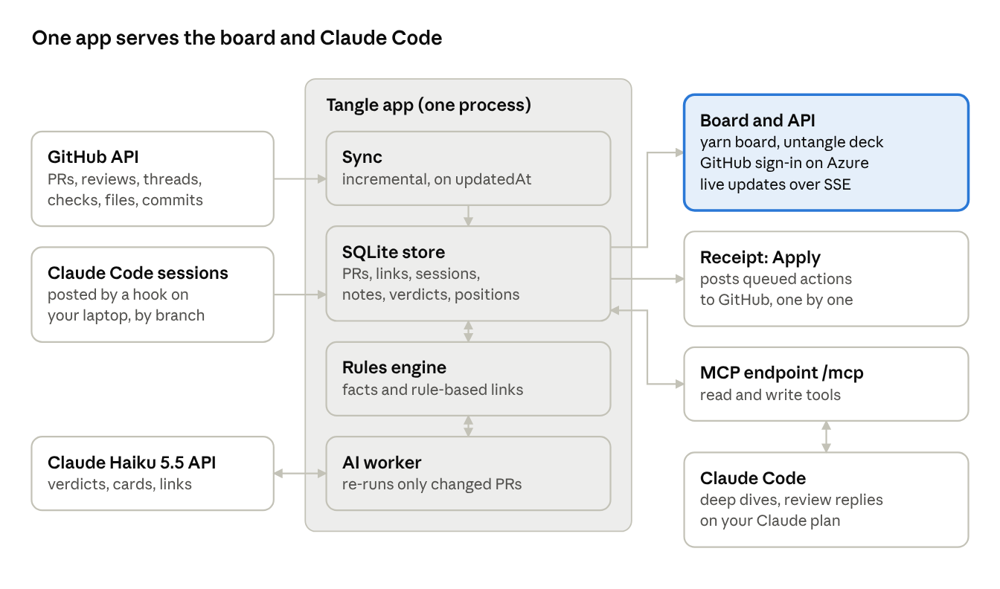

# Tangle: PR triage tool plan

Oct 8, 2026 · @Matej Samler

## The problem

Build a local tool that answers one question every morning: **which of my open PRs do I merge, fix, ping, combine or close, and why?** The backlog is real. On 8 Oct 2026 the five public TALXIS repos you work in hold 98 open PRs, 13 of them yours, most written with an agent.

| Repo | Open PRs | Yours | What stands out |
| --- | --- | --- | --- |
| [TALXIS/platform-metadata](https://github.com/TALXIS/platform-metadata/pulls) | 37 | 0 | 20+ "scaffold applier" PRs from one author in one week (14–21 Sep): a batch, not 25 decisions |
| [TALXIS/tools-cli](https://github.com/TALXIS/tools-cli/pulls) | 34 | 1 | The first page alone goes back to 10 Jun; your #195 carries your own review saying the approach is wrong |
| [TALXIS/alm-lab](https://github.com/TALXIS/alm-lab/pulls) | 13 | 9 | #49 has 4 review comments from 2 Oct, still unanswered: the ball is in your court |
| [TALXIS/tools-devkit-templates](https://github.com/TALXIS/tools-devkit-templates/pulls) | 10 | 3 | Two PRs touch the same pp-flow template (#167 yours, #128 another author's) |
| [TALXIS/docs-patterns-practices](https://github.com/TALXIS/docs-patterns-practices/pulls) | 4 | 0 | All Dependabot bumps from 23 Sep |

Private repos (terraform-provider-powerplatformapi, community-content-planner) are not counted.

The mess has three shapes the GitHub list hides:

- **Links across repos.** tools-cli #195 (connector metadata and flow validation) feeds alm-lab #40 (a cloud flow checkpoint checked against connector metadata). tools-cli #177, by another author, adds connector discovery too and may overlap #195. tools-cli #187 and #174 depend on the platform-metadata scaffold work. These are guesses from titles; confirming them is the tool's job.
- **Whose turn it is.** An open PR is waiting on you, on a reviewer, or on nobody. Nobody is the stale kind, and nothing flags it.
- **Lost context.** Your PRs carry a Claude-Session trailer or a "Generated with Claude Code" footer, but the reasons behind a change live in that agent session, not on the PR. A month later you can't remember why #36 exists.

## What already exists

Existing tools show you the queue. None of them group related PRs across repos, say whether to close one, or remember why it exists. GitHub's own write-up of its new inbox says it makes the queue easier to see but not shorter. That leaves room for a small personal tool.

| Tool | What it does well | What it lacks for this problem |
| --- | --- | --- |
| [GitHub PR dashboard](https://github.blog/changelog/2026-07-09-new-pull-requests-dashboard-is-now-generally-available) (GA Jul 2026) | Inbox sections (review requested, needs fixing, ready to merge), saved views, cross-org search, agent-authored PRs in the author filter | No grouping, staleness ranking, relationships or summaries ([devops.com](https://devops.com/githubs-redesigned-pr-inbox-tackles-the-review-bottleneck-ai-created/)) |
| [Graphite](https://aisotools.com/blog/graphite-review-2026) | Stacked PRs, AI review, merge queue | Only helps PRs made with its own CLI; organization repos start at $20 per user per month; no cross-repo view |
| gh-dash, [prdash](https://pypi.org/project/prdash/) | Terminal dashboards, many repos, CI status | Lists only: no scoring, no LLM, no memory |
| [pr-cluster skill](https://www.skills.sh/openclaw/maintainers/pr-cluster) | Finds duplicate and competing PRs for one target PR | One repo per run, no saved state |

The pressure behind this is growing. Agents opened about 17 million PRs a month on GitHub by March 2026, up from about 4 million in September 2025 ([danilchenko.dev](https://www.danilchenko.dev/posts/2026-04-11-github-ai-agents-pull-requests/)).

## What the tool does

Tangle does four things: it syncs every PR you touch into its own database, scores each one, groups related ones, and keeps the context of why each exists. Facts are computed. An LLM only makes the judgment calls, and every judgment cites the facts it used.

### 1. Per-PR facts, no LLM

| Signal | How it is computed | Why it matters |
| --- | --- | --- |
| Whose turn | Last actor among you, reviewers and CI, plus unresolved threads and review state | "Waiting on me" sorts first; "waiting on nobody" is the stale kind |
| Idle days | Days since last commit, comment or review by a human | Stale means idle, not old |
| Mergeability | Conflicts, commits behind base, CI result | Separates "rebase and merge" from "rethink" |
| Size and spread | Files, lines, top-level folders touched | Big and idle usually means split or close |
| Origin | Claude-Session trailer, Co-Authored-By line, Copilot author, Dependabot | Links the PR to its conversation; Dependabot gets batch handling |

### 2. Relationships, rules first, LLM last

1. **Explicit:** `#n`, `owner/repo#n` and PR URLs in bodies, comments and commits.
2. **Stacks:** one PR's base branch is another PR's head branch.
3. **File overlap:** two open PRs in one repo touching the same files. Likely conflicts or duplicates.
4. **Batches:** same author, same title pattern, same week (the scaffold appliers).
5. **Semantic:** an LLM reads titles, bodies and changed paths and proposes cross-repo links, such as tools-cli #195 and alm-lab #40. Each link is shown as a suggestion with its reason until you confirm it.

### 3. A verdict per PR

Each PR gets one proposed next action with a one-line reason: **merge**, **fix** (reply to review, rebase, fix CI), **ping** (name who), **combine** into another PR, **split**, or **close** (superseded, abandoned, or the approach was rejected). Nothing runs until you approve it. Closing someone else's PR is only ever a suggested comment.

### 4. Conversations and memory

Each PR gets a context card with four parts:

- **Intent:** why it exists, taken from the PR body and the linked agent session.
- **Decisions:** what was decided in review threads and in the session.
- **Open asks:** unresolved review comments, each with its author and date.
- **Your notes:** free text and verdict history you add on the board or through the agent ("parked until the connector API settles").

Notes stay when a PR closes, so a later PR on the same topic can surface them.

## The app: a yarn board, not a table

Tangle is a web app built like a detective's corkboard. PRs are index cards pinned in repo zones, and red yarn ties related PRs together. The [clickable prototype](https://claude.ai/artifact/L3bDk2rXBtoX68vqCiYsnx) (screenshots in [ui/](ui/README.md)) uses your real PRs.

| Part | What you see | What you do |
| --- | --- | --- |
| Board | Cards pinned in repo zones. Pin colour shows whose turn it is, paper yellows after 40 days, and batches show as a stack | Click a card to read its back; drag cards around, and positions are saved |
| Strings | Red yarn for links found by a rule; dashed red with a ? for AI suggestions; navy yarn for strings you tied yourself, labelled with your reason | Tie a suggestion or cut it; tie any two PRs yourself for links only you know about, such as the same customer release. Your ties and cuts survive every sync, and the AI reads your labels |
| Card back | Why it exists, open review asks, linked PRs, the agent session, your notes in handwriting, the suggested next step | Queue the suggestion, add a note |
| Untangle | Your PRs one card at a time: your turn first, then the dustiest | Merge flies right, Close flies left, Snooze drops to the bottom; the AI's pick is highlighted |
| Apply receipt | Queued actions printed on a till roll | Apply posts them to GitHub, asking before each one |

The fun comes from one strong metaphor, satisfying motion when you decide, and a line of knots in the header ("Untied 4 of 13"). There are no points or badges.

## Where the AI runs

**Use both, for different jobs.** The backend calls Claude Haiku 5.5 with an API key for the judgments that should be ready when you open the board. Claude Code, through Tangle's MCP endpoint, handles the work that needs a conversation. The backend does not shell out to `claude -p` on your subscription.

| Job | Where it runs | Why |
| --- | --- | --- |
| Context cards, verdicts, suggested strings | Backend, Claude Haiku 5.5 through the Messages API with your API key | Runs after every sync without you there; JSON output straight into SQLite |
| Deep dives, drafting replies to review comments, reworking code | Claude Code, calling Tangle's MCP tools | Needs back-and-forth and your checkout; that is ordinary Claude Code use on your plan |
| `claude -p` on your subscription from the backend | Not used | [Anthropic's terms](https://code.claude.com/docs/en/legal-and-compliance) send tools built on the Agent SDK to API keys, and the scripted `--bare` mode [ignores the subscription login](https://code.claude.com/docs/en/headless) anyway |

The API key costs next to nothing at this scale. [Haiku 5.5 costs](https://platform.claude.com/docs/en/about-claude/pricing) $0.10 per million input tokens and $0.50 per million output tokens for prompts under 100k tokens. At an assumed 3,000 tokens in and 250 out per PR, a full pass over 44 PRs is about 132k in and 11k out, roughly 2 cents. Re-run only PRs whose `updatedAt` changed, and the daily cost rounds to zero.

This split also keeps Tangle shareable. If colleagues use it, each brings their own API key, which the terms allow; routing their work through your subscription would not be.

## Architecture

Tangle is one web app: on Azure, and on your laptop while you build it. Only two calls leave it, to GitHub and to Haiku. The board, its API and the MCP endpoint for Claude Code all work over the same SQLite store; there is no CLI.

The full design, from the data model to the frontend, is in Technical design.

Sync and the AI worker write to the store; the board and the MCP endpoint read it, and a hook on your laptop reports Claude Code sessions. Whenever anything writes, the open board updates live.

- **Backend:** one ASP.NET Core app on .NET 10, deployed to Azure Container Apps (the design tab has the phases). It serves the board, a minimal API and the MCP endpoint, with Server-Sent Events pushing changes to the board. GitHub through GraphQL; storage is Microsoft.Data.Sqlite; MCP uses the official ModelContextProtocol C# SDK over HTTP.
- **Frontend:** Vite and React. The board uses React Flow, because its nodes are ordinary HTML cards and its edges can be a custom yarn component. Cytoscape.js suits graphs you analyse rather than arrange, which this is not ([comparison](https://articles.firstaimovers.com/articles/react-flow-vs-cytoscape-graph-engine-choice/)).
- **AI worker:** a queue that calls Haiku only for PRs whose `updatedAt` changed, with a JSON schema for each output. The API key lives in the OS keychain or user secrets, never in the repo.
- **Safety:** AI output only ever proposes. The Apply button on the receipt is the only path to GitHub, and it asks before each action.

## Weekend build plan

The web app roughly doubles the work, so the plan splits in two. This weekend ends with a read-only board of your real PRs, with Haiku verdicts and suggested strings. Deciding and applying come in the next sessions.

For an implementing agent, the milestone order with checkpoints where it stops for you replaces the outline below; it is in Implementation order.

**Saturday: data**

- [ ] Settings (watched organizations, the AI switch per repo) and sync: PRs that involve you, saved to SQLite, incremental on `updatedAt`
- [ ] Facts for each PR (whose turn, age, mergeability, size, origin) and rule-based links (references, stacks, file overlap, title batches)
- [ ] Check them on the real backlog: #49 shows as your turn, and the scaffold PRs collapse into one batch

**Sunday: the board**

- [ ] The app: a minimal API (`/prs`, `/links`, `/events`) with the React board embedded, run locally with `dotnet run`
- [ ] Board: repo zones, cards with pin colours and aging paper, yarn edges, and the card back in a side panel
- [ ] AI worker: Haiku writes each card's intent, verdict and reason, and suggests strings for you to tie or cut

**Next sessions**

- [ ] Untangle deck with verdict buttons and the apply receipt
- [ ] Apply from the receipt: posts queued actions, asking before each one
- [ ] Notes, plus the Claude Code session hook that matches sessions to PRs
- [ ] The MCP endpoint and a pr-triage skill for deep dives in Claude Code
- [ ] Tie strings yourself (drag pin to pin) and sticky notes as hubs for business links
- [ ] An Evaluate page scoring deciders on your ties, cuts and Untangle choices; add the Jev adapter once early access comes through
- [ ] Phase 2: the same app on Azure Container Apps with GitHub sign-in, SQLite replicated to Blob Storage, a sync whenever you open the board, Terraform and a GitHub Actions deploy
- [ ] Phase 3, only if colleagues want it: multi-user GitHub sign-in, per-user tokens and private or shared stickies

**Stretch goals:** semantic zoom and Ctrl+K search, a weekly digest as a scheduled task, and Azure DevOps PRs for client work.

## Risks, open questions, verdict

**Verdict: build it.** Unlike `said`, the gap is real: no tool does cross-repo grouping plus a verdict plus memory. You are its first user, with 98 PRs of test data, and colleagues at TALXIS have the same backlog. The background AI costs about 2 cents per full pass on Haiku, and the heavy lifting runs in Claude Code on your plan.

| Risk | Mitigation |
| --- | --- |
| Wrong LLM verdict closes a good PR | Every verdict cites its facts; actions need confirmation; nothing auto-closes |
| A Claude Code update breaks the session hook | Hooks are a documented Claude Code feature; if the hook breaks, the Claude-Session trailer still links cloud sessions |
| GitHub API limits on a full sync | One GraphQL query per page, incremental on `updatedAt`, cached in SQLite |
| Scope creep into a team dashboard | Weekend scope is "PRs that involve me"; the team view waits until the solo version earns it |
| Closing teammates' PRs is a social act | Tangle drafts the comment; you decide and post it |
| UI polish eats the weekend | Ship the board read-only first; motion, dragging and the Untangle deck come after the data is right |

**Open questions**

- Should the default scope be only PRs you authored, or everything you are asked to review as well? The second doubles the value and roughly doubles the noise.
- Do client repos on Azure DevOps belong in version 1, or only after GitHub works?
- Name: "Tangle" is a working title.

## Sources

- [GitHub changelog: new pull requests dashboard is generally available](https://github.blog/changelog/2026-07-09-new-pull-requests-dashboard-is-now-generally-available)
- [devops.com: GitHub's redesigned PR inbox tackles the review bottleneck AI created](https://devops.com/githubs-redesigned-pr-inbox-tackles-the-review-bottleneck-ai-created/)
- [danilchenko.dev: GitHub's AI agent problem](https://www.danilchenko.dev/posts/2026-04-11-github-ai-agents-pull-requests/)
- [Graphite review 2026](https://aisotools.com/blog/graphite-review-2026)
- [prdash on PyPI](https://pypi.org/project/prdash/)
- [pr-cluster skill](https://www.skills.sh/openclaw/maintainers/pr-cluster)
- Open PR lists: [platform-metadata](https://github.com/TALXIS/platform-metadata/pulls), [tools-cli](https://github.com/TALXIS/tools-cli/pulls), [alm-lab](https://github.com/TALXIS/alm-lab/pulls), [tools-devkit-templates](https://github.com/TALXIS/tools-devkit-templates/pulls), [docs-patterns-practices](https://github.com/TALXIS/docs-patterns-practices/pulls)
- PRs read in full: [alm-lab #49](https://github.com/TALXIS/alm-lab/pull/49), [tools-cli #195](https://github.com/TALXIS/tools-cli/pull/195)
- [Claude pricing (Haiku 5.5)](https://platform.claude.com/docs/en/about-claude/pricing)
- [Claude Code: run programmatically (headless and --bare)](https://code.claude.com/docs/en/headless)
- [Claude Code: legal and compliance (authentication and credential use)](https://code.claude.com/docs/en/legal-and-compliance)
- [React Flow vs Cytoscape](https://articles.firstaimovers.com/articles/react-flow-vs-cytoscape-graph-engine-choice/)
- [Tangle UI concept (prototype)](https://claude.ai/artifact/L3bDk2rXBtoX68vqCiYsnx)
