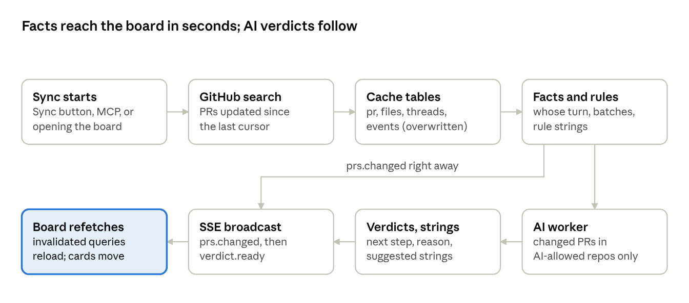
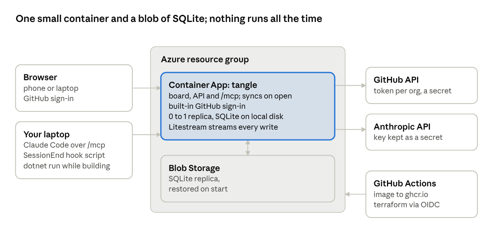

# Tangle: technical design

Oct 9, 2026 · @Matej Samler

Tangle is one ASP.NET Core web app: the yarn board, its API and an MCP endpoint for Claude Code, over one SQLite file. It runs on Azure Container Apps, and on your laptop with `dotnet run` while you build it. There is no CLI: people use the board, agents use MCP, and a small Claude Code hook reports sessions. Three rules hold everywhere: facts are computed, AI judgments are proposals with a confidence and a reason, and nothing reaches GitHub until you confirm it.

## Stack at a glance

| Layer | Choice | Why |
| --- | --- | --- |
| Runtime | .NET 10, one ASP.NET Core app shipped as a container image | Your stack; one deployable serves the board, the API and MCP |
| Web server | ASP.NET Core minimal API on Kestrel | The API and the built board come from the same origin |
| Live updates | Server-Sent Events with `Results.ServerSentEvents` (new in .NET 10) | The board only needs server-to-browser pushes; simpler than SignalR |
| Storage | SQLite with Microsoft.Data.Sqlite and Dapper; numbered `.sql` migrations | One file, zero setup; on Azure, Litestream copies it to Blob Storage |
| GitHub | GraphQL API with a fine-grained token per organization (`gh auth token` works while developing) | One paged query returns PRs with reviews, threads, checks and files |
| AI, now | [Anthropic C# SDK](https://www.nuget.org/packages/Anthropic/) (the official `Anthropic` package), model `claude-haiku-5-5`, [structured outputs](https://platform.claude.com/docs/en/build-with-claude/structured-outputs) | Answers come back as JSON matching a schema, straight into SQLite |
| AI, later | Jev over HTTP, behind the same interface | In early access; switch only if it wins your evaluation |
| MCP | [ModelContextProtocol](https://www-1.nuget.org/packages/ModelContextProtocol.AspNetCore) 1.0 C# SDK, HTTP transport from its ASP.NET Core package | Claude Code connects to `/mcp` like any remote MCP server |
| Sessions | A Claude Code `SessionEnd` hook that posts to `/api/sessions` | The only piece on your laptop: one settings entry and a short script |
| Frontend | Vite, React and TypeScript; React Flow (`@xyflow/react`) for the board; TanStack Query; Zustand; Motion | React Flow gives draggable HTML nodes, custom edges and groups |
| Fonts | Bricolage Grotesque, IBM Plex Mono, Caveat, self-hosted | No third-party requests; all three are under the SIL Open Font License |
| Tests | xUnit, Verify snapshots, Playwright | Facts and API in .NET; the board in a real browser |
| Hosting | Azure Container Apps (0 to 1 replica), SQLite replicated to Blob Storage by Litestream, Terraform, images on ghcr.io | Sleeps when idle and stays inside the free grant; see Phase 2 on Azure |

## How a sync flows



Facts and rule strings reach the board as soon as the cache is written; the AI worker runs afterwards and only for what changed. Your own edits take a shorter path: the board or an MCP tool writes to your tables, the server sends `link.changed` or `sticky.changed`, and the next AI pass reads your labels.

## Repository layout

One solution with a dependency-free core and thin adapters around it, so GitHub, the AI provider or the storage can change without touching the rules.

```text
tangle/
  src/
    Tangle.Host/       entry point: ASP.NET Core host; wires web, MCP and services
    Tangle.Core/       domain model, facts engine, link rules, ports (interfaces)
    Tangle.Data/       SQLite access, migrations/0001_init.sql …
    Tangle.GitHub/     GraphQL client, queries/*.graphql, mappers into Core
    Tangle.Sessions/   takes session reports from the hook, matches them to PRs
    Tangle.Ai/         IDecider, HaikuDecider, JevDecider, schemas, eval runner
    Tangle.Web/        minimal API, SSE broadcaster, auth modes, embedded wwwroot
    Tangle.Mcp/        MCP tools over the same services, HTTP transport
  web/                 Vite + React app; `npm run build` writes into Tangle.Web/wwwroot
    src/board/  src/card/  src/deck/  src/settings/  src/api/  src/theme/
  hooks/               Claude Code session hook: tangle-session.sh and .ps1
  infra/               Terraform (azurerm) for phase 2
  deploy/              Dockerfile, litestream.yml, entrypoint script
  .github/workflows/   build, test, image to ghcr.io, terraform apply
  tests/
    Tangle.Core.Tests/ facts and rules on recorded GitHub JSON
    Tangle.Web.Tests/  API tests with WebApplicationFactory
    Tangle.Ai.Evals/   deciders scored against your labelled strings
    web-e2e/           Playwright
```

References point inwards only: every project may use `Tangle.Core`, and `Tangle.Core` uses none of them. The built web app is an embedded resource of `Tangle.Web`, so the NuGet tool package carries the whole UI.

## Data model

One SQLite file: locally at `~/.tangle/tangle.db`. In Azure it sits on the container's disk, replicated to Blob Storage. GitHub data is a cache that every sync may overwrite; everything you author (ties, cuts, labels, notes, stickies, positions, decisions) lives in its own tables and is never overwritten by a sync.

```sql
-- What GitHub says (rebuilt by sync)
CREATE TABLE repo (id TEXT PRIMARY KEY,            -- 'TALXIS/alm-lab'
  watched INTEGER NOT NULL DEFAULT 1,
  ai_allowed INTEGER NOT NULL DEFAULT 0);            -- see Security
CREATE TABLE pr (id TEXT PRIMARY KEY,              -- 'TALXIS/alm-lab#49'
  repo_id TEXT NOT NULL REFERENCES repo(id), number INTEGER NOT NULL,
  title TEXT, body TEXT, author TEXT, is_mine INTEGER,
  state TEXT, is_draft INTEGER, head_ref TEXT, base_ref TEXT,
  created_at TEXT, updated_at TEXT, closed_at TEXT,
  additions INTEGER, deletions INTEGER, changed_files INTEGER,
  mergeable TEXT, review_decision TEXT, checks_state TEXT,
  content_hash TEXT,                                 -- drives AI re-runs
  batch_id TEXT);
CREATE TABLE pr_file (pr_id TEXT, path TEXT, PRIMARY KEY (pr_id, path));
CREATE TABLE pr_event (pr_id TEXT, at TEXT, actor TEXT,
  kind TEXT,                                         -- commit|comment|review|review_requested|ci
  detail TEXT);
CREATE TABLE review_thread (id TEXT PRIMARY KEY, pr_id TEXT, path TEXT,
  is_resolved INTEGER, last_actor TEXT, last_at TEXT, excerpt TEXT);

-- What Tangle computes
CREATE TABLE fact (pr_id TEXT PRIMARY KEY,
  turn TEXT, turn_reason TEXT,                       -- me|them|nobody + why
  age_days INTEGER, idle_days INTEGER, behind_by INTEGER,
  conflicting INTEGER, size TEXT, origin TEXT,       -- human|agent|bot
  computed_at TEXT);
CREATE TABLE verdict (pr_id TEXT, decider TEXT,    -- 'haiku-5-5' | 'jev'
  action TEXT, confidence REAL, reason TEXT, intent TEXT, priority INTEGER,
  input_hash TEXT, created_at TEXT,
  PRIMARY KEY (pr_id, decider, input_hash));
CREATE TABLE session (id TEXT PRIMARY KEY, path TEXT, cwd TEXT, git_branch TEXT,
  started_at TEXT, pr_id TEXT, matched_by TEXT);     -- trailer|branch|manual

-- What you author (never touched by sync)
CREATE TABLE sticky (id TEXT PRIMARY KEY, title TEXT, color TEXT, archived_at TEXT);
CREATE TABLE link (id TEXT PRIMARY KEY,
  a_ref TEXT NOT NULL, b_ref TEXT NOT NULL,          -- 'pr:…' or 'sticky:…', a_ref < b_ref
  source TEXT NOT NULL,                              -- rule|ai|me
  rule TEXT, status TEXT NOT NULL,                   -- suggested|tied|cut
  confidence REAL, reason TEXT, label TEXT,
  created_at TEXT, decided_at TEXT, UNIQUE (a_ref, b_ref));
CREATE TABLE note (id TEXT PRIMARY KEY, target_ref TEXT, text TEXT, created_at TEXT);
CREATE TABLE position (node_ref TEXT PRIMARY KEY, x REAL, y REAL, moved_by_me INTEGER);
CREATE TABLE action (id TEXT PRIMARY KEY, pr_id TEXT,
  kind TEXT,                                         -- comment|request_review|close|merge|label
  payload TEXT, status TEXT,                         -- queued|applied|dismissed|failed
  created_at TEXT, applied_at TEXT, result TEXT);
CREATE TABLE sync_state (scope TEXT PRIMARY KEY, cursor TEXT, last_run_at TEXT);
```

Two details matter. A cut string is a row with `status = 'cut'`, so the next rule pass or AI pass cannot bring it back. And `link.label` is the text you write on a tie; the AI layer reads it as context, which is how business links you know about steer the suggestions.

## Sync and facts

Sync is one paged GraphQL search per scope, then a pure function from the stored rows to facts. With 50 PRs per page, a page costs roughly 30 rate-limit points against the 5,000 an hour a user token gets ([GitHub limits](https://docs.github.com/en/graphql/overview/rate-limits-and-query-limits-for-the-graphql-api)), so a full sync of your backlog costs under 100.

```graphql
query Prs($q: String!, $after: String) {
  search(type: ISSUE, query: $q, first: 50, after: $after) {
    pageInfo { hasNextPage endCursor }
    nodes { ... on PullRequest {
      id number title body url isDraft state createdAt updatedAt closedAt
      author { login } repository { nameWithOwner }
      headRefName baseRefName mergeable mergeStateStatus reviewDecision
      additions deletions changedFiles
      files(first: 100) { nodes { path } }
      reviewRequests(first: 10) { nodes { requestedReviewer { ... on User { login } ... on Team { slug } } } }
      reviewThreads(first: 50) { nodes { isResolved path
        comments(last: 1) { nodes { author { login } createdAt bodyText } } } }
      commits(last: 1) { nodes { commit { committedDate message statusCheckRollup { state } } } }
      timelineItems(last: 30, itemTypes: [ISSUE_COMMENT, PULL_REQUEST_REVIEW, REVIEW_REQUESTED_EVENT, PULL_REQUEST_COMMIT]) {
        nodes { __typename } }   # expanded per type in the real query file
    } }
  }
  rateLimit { cost remaining resetAt }
}
```

- **Scopes:** `is:pr is:open involves:@me archived:false` plus one `org:` filter per watched organization, from `~/.tangle/config.json`.
- **Incremental:** later runs add `updated:>=<last cursor>`. A second, smaller query with `is:closed` and the same window marks PRs that closed or merged since, so they leave the board.
- **After each sync:** facts are recomputed for every changed PR in one transaction, then one `prs.changed` event goes out (see Local API).
- **When it runs:** when the board opens and the last sync is over 10 minutes old, when you press Sync, and when an MCP read tool finds the data stale. Never in the background. The board shows the stored data at once and updates as the sync and the AI pass finish.

**Whose turn: first matching rule wins.** Bot accounts (Dependabot, GitHub Actions) never count as the last actor.

1. Your PR is a draft: **you**, "finish or close the draft".
2. Your PR has failing checks or conflicts (`mergeable = CONFLICTING`): **you**.
3. Your PR has an unresolved thread whose last comment is someone else's: **you**, "N open review comments".
4. Your PR has `CHANGES_REQUESTED` and no commit since that review: **you**.
5. Someone else's PR requests your review and you have not reviewed since its last commit: **you**.
6. Your PR is approved with green checks: **you**, "ready to merge".
7. No human activity for 21 days or more: **nobody**.
8. Otherwise: **them**, naming the requested reviewer when there is one.

**Other facts.** Origin is `agent` when the body or a commit has a `Claude-Session:` trailer, a Claude `Co-Authored-By` line or a "Generated with Claude Code" footer, or the author is Copilot; `bot` for Dependabot. Size buckets are XS to XL by lines changed. A batch is five or more PRs in one repo by one author within 14 days whose titles share a pattern once identifiers are stripped ("feat: … scaffold applier for pp-…").

**Sessions.** A `Claude-Session:` trailer links a PR to its cloud session directly. Local Claude Code sessions are reported by a hook: when a session ends, a short script on your laptop reads the hook's JSON (`session_id`, `transcript_path`, `cwd`), adds the repo's git remote and the current branch, and posts them to `/api/sessions` with your personal key. Tangle matches the branch to the PR's head branch. Transcripts stay on your laptop; if you opt in, the script also sends your first prompt as a one-line excerpt for the card back. Claude Code also has an `http` hook type that posts the hook JSON without any script, but that JSON carries no repo or branch, hence the script. You can attach a session by hand on the card back too.

## Strings and sticky notes

Every string is a `link` row with a source and a status, so rules, the AI and you all draw on the same board and your decisions always win.

| Source | How it is found | On the board | After you cut it |
| --- | --- | --- | --- |
| Rule | `#n`, `owner/repo#n` or PR links in bodies, comments and commits; one PR's base branch is another's head (a stack); two open PRs in one repo share changed files | Solid red yarn, a check-mark tag | Stays cut; the rule skips that pair |
| AI | The decider is asked "are these two related?" for candidate pairs; shown only above 0.75 confidence | Dashed red yarn, a ? tag | Stays cut; the pair is never asked again |
| You | Drag from one card's pin to another's on the board | Navy yarn, with your label on it | Gone; you can tie it again |

**Candidate pairs.** Asking about every pair grows fast (946 pairs for 44 PRs), so a cheap pre-filter picks candidates first: shared words in titles, shared folders in changed paths, the same author within 30 days, or a mention of the same product name. Pairs already tied or cut are skipped.

**Sticky notes for business links.** A sticky is a board node with a title you write, such as "Customer release, November" or "Conference demo". You tie PRs to it like to a card, so one note gathers everything that serves one goal across repos.

- The sticky shows how many tied PRs are merged, as a row of knots that fill in.
- When every tied PR is merged, the sticky offers to archive itself.
- The decider can suggest new members: "does this PR belong to *Customer release, November*?" Suggestions appear as dashed strings to the sticky, the same as between PRs.
- Sticky titles and your string labels go into the AI's context, so a link only you know about shapes its next-step suggestions.

**Status changes.** `suggested` becomes `tied` or `cut`; `tied` becomes `cut`; only you can turn `cut` back into `tied`. Every change sets `decided_at`, which the AI evaluation uses as labelled data.

## AI layer

Every AI call goes through one interface, so Haiku and Jev are interchangeable per job and can be compared on your own data. The AI never writes to GitHub and never changes a fact; it only fills the `verdict` table and suggests `link` rows.

```csharp
public interface IDecider
{
    string Name { get; }   // "haiku-5-5", "jev"
    Task<PrJudgment> JudgePrAsync(PrContext pr, CancellationToken ct);
    Task<IReadOnlyList<LinkJudgment>> JudgePairsAsync(IReadOnlyList<PairContext> pairs, CancellationToken ct);
}

public enum NextAction { Merge, Fix, Ping, Wait, Close, Split }
public sealed record PrJudgment(NextAction Action, double Confidence, int Priority, string? Reason, string? Intent);
public sealed record LinkJudgment(string ARef, string BRef, double Related, string? Reason);
```

**What the decider sees (`PrContext`).** Title, the first 4,000 characters of the body, up to 100 changed paths, the computed facts with the whose-turn reason, up to 5 open review comments (300 characters each), linked PRs, your string labels and sticky titles. Never diffs or file contents.

|  | Haiku adapter | Jev adapter |
| --- | --- | --- |
| Call | Messages API, model `claude-haiku-5-5`, `output_config.format` with a JSON schema | `POST https://api.typesafe.ai/v1/systemone`, model `jev-latest` |
| Next step | `action` as a string enum in the schema | A `choice` question over the six actions |
| Priority | Integer field (the schema cannot enforce 1 to 5, so the code clamps it) | A `score` question on five levels |
| Related pairs | 20 pairs per request, returned as an array | One `noul` question per pair: "same piece of work, or one depends on the other" |
| Reason and intent | Written in the same call | Not available: the card shows the whose-turn reason, and Haiku writes a reason only when you open the card |
| Confidence | Self-reported by the model, so treat it as a rough signal | Returned as a probability by design; the evaluation checks whether it is calibrated |

Which decider handles which job is configuration (`ai.verdicts`, `ai.pairs`, `ai.explain`), defaulting to Haiku for all three.

**Caching and cost.** Each call's input is hashed with the decider name and the prompt version (`prompts/verdict.v1.md`), and the result is stored under that hash, so only PRs that changed are sent again. The system prompt and schema stay identical across calls, which makes them cacheable. An `ai_call` log table (not shown above) records tokens, cost and latency per call, and a monthly budget in the config stops the worker when it is reached.

**Evaluation.** Your decisions become the answer key. Every string you tied or cut, and every Untangle choice you made, is a labelled example. An Evaluate page in the board (or the `Tangle.Ai.Evals` test project from your IDE) replays them through each configured decider and writes a Markdown report:

- **Strings:** precision and recall at the 0.75 threshold.
- **Next steps:** how often the decider picked what you picked.
- **Calibration:** Brier score, which tests whether "80% sure" is right about 80% of the time.
- **Cost and latency** per 100 calls.

Switch a job to Jev only when its report beats Haiku's on your own backlog.

## Local API and live events

The app serves the board and a small JSON API from the same origin: on Azure behind built-in sign-in, and on `localhost` when you `dotnet run` it. The board loads in one request, then stays current through one Server-Sent Events stream; every write goes through the API.

| Method and path | Does |
| --- | --- |
| `GET /api/board` | Everything for first paint: zones, cards (PR, facts, latest verdict), stickies, strings, saved positions |
| `GET /api/prs/{owner}/{repo}/{number}` | The card back: facts, open threads, recent events, session, notes, verdict history |
| `POST /api/links` | Tie two cards or a card and a sticky, with an optional label |
| `PATCH /api/links/{id}` | Tie a suggestion, cut a string, or change its label |
| `POST /api/stickies`, `PATCH /api/stickies/{id}` | Create, rename, recolour or archive a sticky |
| `PUT /api/positions/{nodeRef}` | Save where you dropped a card or sticky |
| `POST /api/notes` | Pin a note to a card, sticky or string |
| `POST /api/actions`, `DELETE /api/actions/{id}` | Queue or drop an action on the receipt |
| `POST /api/actions/{id}/apply` | Post one queued action to GitHub; the UI asks first |
| `POST /api/sync` | Start a sync; progress arrives as events |
| `GET /api/events` | The Server-Sent Events stream |
| `POST /api/sessions` | Session reports from the Claude Code hook (personal key) |
| `/mcp` | The MCP endpoint for Claude Code (personal key) |
| `GET /healthz` | Liveness for Container Apps probes |

**Event types on `/api/events`:** `sync.started`, `sync.progress`, `sync.finished`, `prs.changed` (list of ids), `verdict.ready`, `link.changed`, `sticky.changed`, `action.changed`, `ai.budget`. Each carries an increasing id, so a reconnecting browser sends `Last-Event-ID` and receives what it missed from a short in-memory buffer; if the gap is too old, the server answers with `board.reload`.

The browser does not patch its state from events. Each event only invalidates the matching TanStack Query keys, and the queries refetch, so the API stays the single source of truth. MCP tools and the session endpoint run inside the same app, so their writes raise the same events and an open board updates when Claude Code proposes something.

## MCP, settings and the session hook

There is no CLI. People use the board; agents use the MCP endpoint at `/mcp`, which calls the same services as the API. Everything a CLI would have done has a home:

| Job | Where it lives |
| --- | --- |
| Sync, list, show, tie, note, queue | The board; for agents, the MCP tools below |
| Apply queued actions | The receipt in the board, one confirmation per action |
| Watched repos, AI switch per repo, budget | A Settings page; tokens and keys are app secrets, never typed into the browser |
| Compare deciders | The Evaluate page, or the `Tangle.Ai.Evals` test project |
| Report Claude Code sessions | The session hook on your laptop |

Connecting Claude Code is one command (user scope, so every project sees it), and the hook is one entry in `~/.claude/settings.json`:

```bash
claude mcp add --transport http tangle https://<your-app>.azurecontainerapps.io/mcp \
  --scope user --header "Authorization: Bearer <personal key>"
```

```json
{ "hooks": { "SessionEnd": [ { "hooks": [
  { "type": "command", "command": "~/.claude/hooks/tangle-session.sh" }
] } ] } }
```

The script reads the hook's JSON from standard input, runs `git remote get-url origin` and `git branch --show-current` in its `cwd`, and posts the result. A PowerShell twin covers Windows. If the app is asleep, the post simply wakes it.

**MCP tools.** Read tools: `list_prs`, `get_pr_context`, `get_threads` (groups of cards joined by strings or a sticky), `get_eval_report`. Write tools only make proposals: `add_note`, `propose_link` (appears as a dashed string for you to judge), `record_verdict`, `queue_action`. There is deliberately no `apply` tool, so an agent can fill your receipt but never post to GitHub.

A `pr-triage` skill shipped in the repo tells Claude Code how to work with these tools: start from `get_threads`, read the card back before proposing anything, and put the reason in every proposal.

## Frontend

A single-page React app with two views, Board and Untangle, a side panel, and a receipt. The [prototype](https://claude.ai/artifact/L3bDk2rXBtoX68vqCiYsnx) (screenshots in [ui/](ui/README.md)) is the visual reference; this section is how to build it for real.

```text
App
├ TopBar        view switch · counts · knot meter · others toggle · sync · receipt
├ BoardView
│  ├ ReactFlow  nodes: ZoneNode (group) · PrCardNode · BatchNode · StickyNode
│  │            edges: YarnEdge (rule | ai | mine)
│  ├ TieBanner  "pick the card to tie #49 to"
│  └ Legend
├ SidePanel     CardBack | StringPanel | StickyPanel
├ UntangleView  Deck · VerdictBar · Receipt
└ Toasts        sync progress, applied actions, budget warnings
```

**State.** Server data lives in TanStack Query, keyed per resource (`board`, `pr/<id>`, `actions`), and SSE events invalidate those keys. UI state (selection, view, tie mode, filters, zoom level) lives in one small Zustand store. Nothing is duplicated between the two.

**The board.**

- **Zones** are React Flow group nodes, one per repo, packed in a grid sized by card count. Cards are their children (`parentId`, `extent: 'parent'`), because a PR cannot leave its repo. Stickies are top-level nodes and go anywhere.
- **First layout** sorts cards inside each zone by whose turn, then by idle days. Once you drag a card, its saved position wins on every later render.
- **Strings** are a custom `YarnEdge`: a quadratic curve that sags by 30 plus 12% of its length, drawn twice (a soft shadow, then the yarn). Red solid for rules, red dashed for AI suggestions, navy for yours. The tag at the midpoint is a real button rendered with `EdgeLabelRenderer`. Edges sit above the cards through a higher `zIndex`, like real string on a corkboard.
- **Tying** has two ways in. Each card's pin is a React Flow `Handle`, so dragging from one pin to another fires `onConnect`, which posts the link and opens a label popover. For keyboard users, the card back's "Tie a string" button enters pick mode, as in the prototype.
- **Semantic zoom.** Below 60% zoom, cards shrink to number and pin; below 35%, each zone collapses to a summary ("alm-lab: 2 your turn, 1 stale"). A selector on React Flow's zoom drives this.
- **Finding things:** Ctrl+K opens a search over titles and numbers, then pans and zooms to the card.

**Untangle.** The deck holds your PRs: your turn first, then nobody's turn by idle days, then the rest by age. Keys M, F, P, W, X and S decide; U undoes the last decision and takes it off the receipt. Motion animates each exit (Merge right, Close left, Snooze down, the rest up) and, with `prefers-reduced-motion`, cards fade instead of flying.

**Receipt and apply.** Queued actions print on a till roll. Apply opens one confirmation per action showing exactly what will be posted (the comment text, the reviewer, or the close message) and the result comes back through `action.changed`.

**Visual tokens.** CSS variables: cork `#B98B5B`, paper `#FBF6EA`, aged paper `#EDE0C2`, ink `#221C15`, red yarn `#B3262F`, your yarn `#1F3F8A`, pins `#E4572E` (your turn), `#2D6BD6` (waiting on others) and `#8C857B` (nobody). Bricolage Grotesque for UI, IBM Plex Mono for numbers, Caveat only for your own handwriting (notes and labels).

**Accessibility.** Every card, tag and pin is a real button with a full label ("alm-lab #49, your turn: Add CP16 and CP17…"). Tab moves zone by zone; arrow keys move focus to the nearest card in that direction. Colour is never the only signal: the stamp spells "YOUR TURN" or "STALE", and strings are listed as text on the card back. Text keeps 4.5:1 contrast on paper.

**Scale.** React Flow's `onlyRenderVisibleElements` keeps a few hundred cards smooth; beyond that, semantic zoom does the rest.

## Security and privacy

Tangle handles client data and is reachable over the web, so these rules hold from the first version.

- **Locally, while you build,** the app binds to 127.0.0.1 only, requires a development key, and rejects any request whose `Host` or `Origin` is not its own address, which blocks other websites and DNS-rebinding tricks. On Azure, built-in GitHub sign-in takes over (see Phase 2 on Azure).
- **GitHub tokens are secrets, not data.** On Azure, one fine-grained token per organization lives in the app's secrets; while developing, `gh auth token` is enough. Posting comments, requesting reviews and closing PRs use the permissions those tokens have, so grant them only the repos Tangle watches.
- **AI keys stay out of the database.** `ANTHROPIC_API_KEY` and `TYPESAFE_API_KEY` are app secrets on Azure and environment variables locally, never stored in SQLite.
- **AI is opt-in per repo.** `repo.ai_allowed` defaults to off, and the Settings page asks per organization. Only `PrContext` is sent to the AI (titles, bodies, changed paths, review-comment excerpts, your labels), never diffs or file contents. For client repos, check the client's contract and your company's AI policy before turning it on, because a PR body can contain customer details.
- **PR text is untrusted.** Bodies and comments are written by other people and could contain instructions aimed at an AI. They go to the decider as data, the decider can only answer within its schema, the MCP server has no apply tool, and every post to GitHub needs your confirmation. The worst a hostile PR description can do is produce a bad suggestion.
- **Rendering.** The UI shows PR text as plain text (React escapes it); if Markdown rendering is added later, it goes through a sanitizer.

## Deployment in three phases

The same binary runs in every phase; only configuration changes: where the data lives, how you sign in and where tokens come from. Phase 1 is the weekend build, phase 2 puts it on Azure for you alone, and phase 3 opens it to colleagues if it earns that.

|  | Phase 1: while you build | Phase 2: Azure, just you | Phase 3: a team, if ever |
| --- | --- | --- | --- |
| Runs as | `dotnet run` on your laptop | One Azure Container App, scaling between 0 and 1 replica | The same app, still one replica |
| You open it from | localhost | Any browser, over HTTPS | Any browser |
| Sign-in | A development key | Container Apps built-in sign-in with GitHub; the app admits only your login | The same, for a list of GitHub users or an organization |
| Storage | A local SQLite file | SQLite on the container's disk, streamed to Blob Storage by Litestream | The same; a server database only if one replica stops being enough |
| GitHub access | `gh auth token` | One fine-grained token per organization, stored as app secrets | Each user's own GitHub token from sign-in, encrypted |
| Sync | When you open the board or press Sync | When you open the board (if the last sync is over 10 minutes old) or press Sync | When each person opens the board |
| AI key | Environment variable | App secret | One company key for colleagues, with a budget per user |
| Claude Code sessions | The session hook posts to localhost | The session hook posts to the app | Each person's hook posts their own |
| MCP | HTTP at `localhost/mcp` | HTTP at `/mcp`, with a personal key | A personal key per user |

Fine-grained GitHub tokens each cover a single user or organization, hence one per organization (TALXIS, your own account) in phase 2. Using one company AI key for colleagues fits Anthropic's terms, which allow keys provisioned for your organization's own authorized users.

## Phase 2 on Azure

One Container App serves the board, the API and `/mcp`, sleeps when nobody uses it, and keeps its SQLite file safe in Blob Storage. It should cost close to nothing.



The browser and Claude Code reach the app over HTTPS. Opening the board wakes it and starts a sync; nothing runs in the background; every write streams to Blob Storage, and a fresh replica restores from there before it starts serving.

**Why SQLite and not Azure SQL.** The [Azure SQL free offer](https://learn.microsoft.com/en-us/azure/azure-sql/database/free-offer) gives 100,000 vCore seconds a month. A serverless database bills at its minimum of 0.5 vCores while online and [pauses only after at least 15 idle minutes](https://learn.microsoft.com/en-us/azure/azure-sql/database/serverless-tier-overview), so every wake costs at least 450 vCore seconds. With sync on demand that still fits one person (about 200 visits a month), but each first visit would wait for the database to resume on top of the container starting, and a team in phase 3 would outgrow the allowance. SQLite on the container's disk with [Litestream](https://litestream.io/guides/azure) replicating to Blob Storage costs only the storage, and the code keeps one storage engine in every phase.

**Single-writer rules.** SQLite with Litestream must have exactly one writer.

- The app runs with a maximum of 1 replica.
- On start, the app takes a lease on a lock blob and holds it; during a deploy, the new revision waits until the old one lets go, so two revisions never write at once.
- The container entry point restores the database from Blob Storage when the local file is missing, then starts the app under Litestream's replicate command, which uploads changes until shutdown.
- Litestream authenticates with the app's managed identity, which holds the Storage Blob Data Contributor role; no storage key is stored.

**Monthly cost, with assumptions.** The [Container Apps free grant](https://azure.microsoft.com/pricing/details/container-apps/) is 180,000 vCPU seconds, 360,000 GiB seconds and 2 million requests per subscription each month.

| Item | Assumption | Expected cost |
| --- | --- | --- |
| Container App, 0.25 vCPU and 0.5 GiB | About 20 hours of use a month, each visit staying up about 5 minutes after you leave: roughly 23,000 vCPU seconds and 45,000 GiB seconds, an eighth of the grant | Inside the free grant |
| Blob Storage | Under 100 MB of database and replica history | Cents |
| Container registry | Images on ghcr.io instead of Azure Container Registry, which bills daily | Free |
| Logs | Environment without Log Analytics, or with a small daily cap | Free, or capped |
| Anthropic | Incremental Haiku runs on changed PRs only | Cents |

The usual surprises on Azure are a container registry and log ingestion, so both are avoided by design. Set a budget alert on the resource group anyway.

**Infrastructure as code.** Terraform with the `azurerm` provider in `infra/`: resource group, storage account and container, Container Apps environment, and the app (scale 0 to 1, external HTTPS ingress, managed identity, secrets, GitHub sign-in). No scheduled job: syncs only run when you use the board. A GitHub Actions workflow builds the image, pushes it to ghcr.io and runs `terraform apply`, signing in to Azure with an OIDC federated credential, so no Azure secret is stored in GitHub.

**Sign-in.** Built-in authentication with the GitHub provider handles the login, and the app reads the signed-in user from the `X-MS-CLIENT-PRINCIPAL-NAME` header that the platform sets ([Container Apps authentication](https://learn.microsoft.com/azure/container-apps/authentication)). The platform lets unauthenticated requests through to the app, and the app decides per route: the board and its API, sync included, need an allowed GitHub login, while `/mcp` and `/api/sessions` need a personal key, because Claude Code and the session hook cannot do a browser login.

**Build into phase 1 now, so phase 2 is configuration only.**

- Sign-in as swappable middleware with three modes: local token, Container Apps user plus allowlist, personal key.
- Sync triggered over HTTP (`POST /api/sync`) by the board and by MCP tools.
- Session matches sent through `POST /api/sessions`, even locally.
- MCP over HTTP only, through the ASP.NET Core package of the MCP SDK, so local and Azure work the same way.
- All settings readable from environment variables, a `/healthz` endpoint for probes, and a 30-second heartbeat on the event stream so proxies keep it open.

## Phase 3, if ever: a team

The same app and the same SQLite file can serve a team of a few dozen; what changes is who owns which rows and whose token sees which PRs.

- **Users and ownership.** A `user` table keyed by GitHub login. Every row you author (ties, cuts, labels, notes, stickies, positions, queued actions) gains an `owner_id`. Stickies and strings are private by default, with a "share with team" switch, so a team sticky like "Customer release, November" can gather everyone's PRs.
- **Nobody sees a PR their GitHub account cannot.** PR data is cached once, but each user's own sync writes `pr_access(user_id, pr_id)` rows, and every board query joins on them. Private repos never leak between colleagues.
- **GitHub tokens per user.** Sign-in still uses built-in authentication. For API access, each person authorizes Tangle's GitHub OAuth app once; the token is encrypted with ASP.NET Core Data Protection, whose keys live in Blob Storage, wrapped by Key Vault. Check first whether the Container Apps token store can hand the GitHub token to the app directly; if so, that step disappears.
- **Actions post as the person who queued them,** with their own token, so GitHub shows who closed or commented.
- **AI.** One company key, a monthly budget per user tracked in the `ai_call` table, and the per-repo AI switch becomes an admin setting.
- **Storage.** One SQLite writer handles many readers and a team's worth of small writes. Move to Azure SQL or PostgreSQL only if you need more than one replica; the storage interface keeps that change inside `Tangle.Data`.

## Testing

Most of Tangle is pure functions over recorded data, so most tests need no network.

| Area | How | Must prove |
| --- | --- | --- |
| Facts and rules | xUnit over recorded GraphQL responses (scrubbed JSON fixtures), one case per whose-turn rule; Verify snapshots of the full fact table | #49 comes out as your turn; the scaffold applier PRs collapse into one batch; bots never count as the last actor |
| Sync | A fake GraphQL handler | Incremental cursor works; closed PRs leave the board; your ties, cuts and positions survive |
| API | `WebApplicationFactory` | Requests without the token or with a foreign `Origin` fail; a link change emits `link.changed` |
| UI | Playwright against the app started with `--demo`, a seeded database | Tie by dragging pin to pin and by keyboard; a cut string stays cut after a sync; Untangle keys and undo; reduced motion |
| AI | Recorded responses in unit tests; live checks only through the Evaluate page | Every prompt's schema is accepted by the API; malformed or low-confidence answers never become strings |

The `--demo` database doubles as a talk prop: an anonymised backlog that shows the board without exposing client repos.
