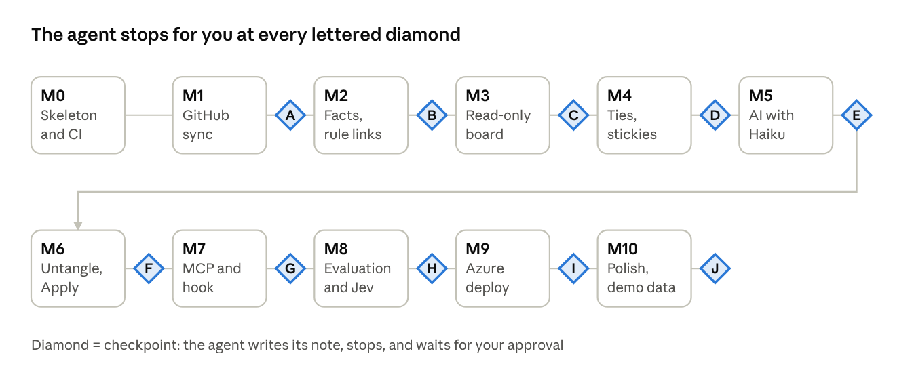

# Tangle: implementation order

Oct 9, 2026 · @Matej Samler

Build Tangle in eleven milestones, M0 to M10, and stop at each of the ten checkpoints (A to J) until Metju approves. Each milestone is usable on its own, so a wrong turn costs one milestone, not the project.

## How to work

**Sources of truth.** The Plan tab says what and why; the Technical design tab says how (stack, schema, API, rules); the [prototype](https://claude.ai/artifact/L3bDk2rXBtoX68vqCiYsnx) (screenshots in [ui/](ui/README.md)) is the visual reference. When they disagree or leave a gap, do not invent: write the question down and raise it at the next checkpoint. Record every decision in `docs/DECISIONS.md` (date, question, answer).

**Rhythm per milestone.**

1. One branch and one pull request per milestone. Do not open more PRs than that; this tool exists because of PR piles.
2. Small commits with clear messages; tests in the same commits as the code.
3. Finish with all tests green in CI and the "Done when" list ticked.
4. Write `docs/checkpoints/<letter>.md`: what was built, how to run it, a demo script of at most 15 minutes, deviations from the design, and open questions.
5. Stop. Ask Metju to review. Start the next milestone only after he approves; then merge the PR.

**Never, at any milestone, without Metju's explicit go-ahead in that conversation:**

- Post anything to GitHub on a real PR: no comments, review requests, closes or merges. Use the sandbox repo from M6.
- Send data from any repo to an AI provider before Metju has set that repo's AI switch.
- Create Azure resources, run `terraform apply`, or do anything that costs money.
- Commit secrets. Tokens and keys come from environment variables or `dotnet user-secrets`; `.gitignore` covers `*.db`, `.env` and `appsettings.*.local.json`.
- Delete or rewrite the SQLite file Metju uses day to day; migrations only move forward.
- Swap a library or pattern named in the design for another one.

**Tests.** Unit tests never call GitHub or an AI. Record real responses once, scrub names and bodies where needed, and keep them under `tests/fixtures/`.

## Roadmap at a glance

The order follows the dependencies: data before facts, facts before the board, the board before anything you author on it, and the AI only once there is something to judge. Azure comes late on purpose, when there is something worth hosting; the code is cloud-ready from M0 because of the design's sign-in modes and HTTP-only interfaces.

## M0 Skeleton and pipeline

A running, empty app with its database, its web shell and CI, so every later milestone only adds features. No checkpoint: continue straight into M1.

**Build**

- [ ] The solution laid out exactly as in the design's repository layout: `Tangle.Host`, `Core`, `Data`, `GitHub`, `Sessions`, `Ai`, `Web`, `Mcp`, the `web/` app and the `tests/` projects.
- [ ] `Tangle.Host`: ASP.NET Core minimal API on .NET 10, settings from environment variables and `dotnet user-secrets`, `GET /healthz`, and the local sign-in mode (a development key plus the `Host`/`Origin` check).
- [ ] `Tangle.Data`: a migration runner that applies numbered `.sql` files in order and records them, and `0001_init.sql` with the full schema from the design.
- [ ] `web/`: Vite, React and TypeScript with a placeholder page and the self-hosted fonts; `npm run build` writes into `Tangle.Web/wwwroot`, embedded in the app.
- [ ] One passing test in each test project, and a Playwright smoke test that opens the page.
- [ ] GitHub Actions: build and test .NET and web, run Playwright, on every push to a PR.
- [ ] `docs/DECISIONS.md` and `docs/checkpoints/`.

**Done when**

- [ ] `dotnet run` serves the placeholder board at localhost and `/healthz` answers OK.
- [ ] A fresh start creates the SQLite file with every table from the design; a second start applies nothing.
- [ ] CI is green.

## M1 GitHub sync

Real PR data in SQLite, refreshed on demand and cheaply.

**Build**

- [ ] GitHub client with the design's GraphQL query in `queries/Prs.graphql`, paging, and the `rateLimit` cost logged per call.
- [ ] Tokens: `gh auth token` in development; one fine-grained token per organization from settings (owner to token).
- [ ] Watched organizations and repos stored in SQLite, with `GET`/`PUT /api/settings` and a plain, unstyled Settings page.
- [ ] Sync: the open-PR search per scope, the incremental `updated:>=` cursor, the closed-PR query, upserts into the cache tables, `content_hash` per PR, and `sync_state`.
- [ ] `POST /api/sync` and `GET /api/board` (cards without facts for now).
- [ ] A temporary `/debug/prs` page: one plain table of every stored PR. It is deleted in M3.
- [ ] Fixtures recorded from Metju's real responses, scrubbed where needed.

**Done when**

- [ ] Tests cover paging, the incremental cursor, closed-PR removal, and that a repeated sync changes nothing.
- [ ] A sync of Metju's account stores his open PRs from TALXIS and his own repos.
- [ ] A second sync a minute later costs only a few rate-limit points.

**Checkpoint A: is the data complete?** Metju runs a sync with his tokens and opens `/debug/prs`.

- He checks that every PR he expects is there, private repos included, and no closed PR is.
- He decides which organizations and repos are watched by default, and whether PRs where his review is requested are in scope from the start (an open question in the Plan tab).

## M2 Facts and rule strings

Every PR gets its computed facts, and rule-based strings appear, all without AI.

**Build**

- [ ] The facts engine in `Tangle.Core` as pure functions over stored rows: whose turn (the design's eight ordered rules, each with its reason text), age and idle days, mergeability, size bucket, origin (agent, bot, human).
- [ ] Bot accounts excluded from "last actor"; the list of bot logins is a setting.
- [ ] Batches: five or more PRs, one repo, one author, 14 days, a shared title pattern.
- [ ] Rule strings written to `link` with `source = 'rule'`: explicit references, stacks, shared changed files. A row with `status = 'cut'` is never recreated.
- [ ] Facts recomputed after each sync in one transaction; `GET /api/board` now carries facts, batches and strings.
- [ ] `/debug/prs` gains columns for whose turn, its reason, origin and batch, plus a list of strings.

**Done when**

- [ ] One test per whose-turn rule, plus a Verify snapshot of the facts for the recorded fixture backlog.
- [ ] On the fixtures, alm-lab #49 is "your turn" with "4 open review comments", and the platform-metadata scaffold-applier PRs form one batch.

**Checkpoint B: does the tool see your backlog as you do?** Metju reads the debug table for his own PRs.

- For each PR he marks whether whose-turn and its reason are right. Every disagreement becomes a rule fix or a decision in `DECISIONS.md`.
- He decides the thresholds: 21 days for "nobody's turn", 40 days for yellowed paper, and the batch rule.

## M3 Read-only board

The yarn board on real data: look and read, no editing yet. This is the milestone where Tangle starts to feel like Tangle.

**Build**

- [ ] React Flow board: repo zones as group nodes, `PrCardNode`, `BatchNode`, and `YarnEdge` for rule strings, following the prototype's look and the design's visual tokens.
- [ ] First layout: zones packed in a grid, cards inside sorted by whose turn, then idle days.
- [ ] Pins coloured by whose turn, stamps ("YOUR TURN", "STALE"), aged paper past the threshold.
- [ ] Card back in the side panel: facts, open review comments, strings, from `GET /api/prs/{owner}/{repo}/{number}`.
- [ ] Top bar: counts, Sync button, the others' PRs toggle.
- [ ] Sync when the board opens and the last sync is over 10 minutes old; the stored board shows at once.
- [ ] Server-Sent Events: `/api/events` with ids and a 30-second heartbeat; the browser invalidates TanStack Query keys on each event.
- [ ] Delete `/debug/prs`.

**Done when**

- [ ] Playwright: the board renders from the fixture database; clicking a card opens its back; a sync event refreshes a card.
- [ ] With Metju's real backlog (about 45 PRs), panning and zooming stay smooth.

**Checkpoint C: look and feel.** Metju opens the board on his own data for ten minutes, the same way he will use it on a Monday morning.

- He checks: can he tell within a few seconds what needs him? Are the zones, cards and strings readable at his usual zoom?
- He decides visual changes against the prototype before anything is built on top of the board.

## M4 Your strings, stickies, notes and positions

Everything Metju authors on the board, saved in his own tables and never touched by a sync.

**Build**

- [ ] Tie by dragging from one card's pin to another's (React Flow `Handle` and `onConnect`), then a label popover; tie by keyboard through the card back's "Tie a string" button and pick mode.
- [ ] Navy yarn for his strings, labels shown on the string panel; cut and re-tie; cut rule strings stay cut.
- [ ] Stickies: create, rename, recolour, archive; tie PRs to a sticky; the knot row fills as tied PRs merge; offer to archive when all are merged.
- [ ] Notes on cards, stickies and strings, shown in the handwriting font.
- [ ] Dragging saves positions through `PUT /api/positions/{nodeRef}`; saved positions win over the first layout.
- [ ] The write endpoints from the design (`/api/links`, `/api/stickies`, `/api/notes`, `/api/positions`) with matching `link.changed` and `sticky.changed` events.

**Done when**

- [ ] Playwright: tie by drag and by keyboard; cut; add a sticky and tie two PRs to it; add a note; move a card and reload.
- [ ] A test proves a full sync keeps every tie, cut, label, note, sticky and position.

**Checkpoint D: does tying feel right?** Metju ties three real business links he knows about, creates one sticky for a real goal, and moves cards to his liking.

- He checks that it is quick and that everything is still there after a sync and a browser restart.
- He decides on label prompts (always ask, or optional) and the sticky colours.

## M5 AI suggestions with Haiku

Suggested next steps, reasons and dashed strings on the board, from Haiku, only for repos Metju allows.

**Build**

- [ ] The AI switch per repo in Settings, off by default. **Before the first real call, stop and ask Metju to set it.**
- [ ] `IDecider` and `PrContext` exactly as in the design; `HaikuDecider` using the official `Anthropic` package, model `claude-haiku-5-5`, structured outputs via `output_config.format`.
- [ ] Prompts as versioned files (`prompts/verdict.v1.md`, `prompts/pairs.v1.md`); results cached by input hash in `verdict`.
- [ ] Candidate pairs from the cheap pre-filter, judged 20 per request; suggestions above 0.75 become dashed strings; tied or cut pairs are never asked again.
- [ ] Sticky membership suggestions, using the sticky titles and Metju's labels as context.
- [ ] The `ai_call` log (tokens, cost, latency) and the monthly budget that stops the worker.
- [ ] The card back shows the suggested next step with its reason; dashed strings get their ? tag and the tie-or-cut panel.

**Done when**

- [ ] Unit tests on recorded Haiku responses; a test that a malformed or low-confidence answer never becomes a string.
- [ ] A real run over Metju's allowed repos completes, and its cost appears in the log.

**Checkpoint E: are the suggestions worth reading?** Metju reads the suggested next step on ten cards and judges every dashed string.

- He checks the reasons against what he knows, and the cost of the run.
- He decides the threshold (0.75 or another), whether to change the prompts, and which client repos may stay on.

## M6 Untangle, receipt and Apply

Decide PRs one card at a time, collect the decisions on the receipt, and post them to GitHub with a confirmation for each.

**Build**

- [ ] Untangle view: the deck order from the design, verdict buttons with the AI's pick highlighted, keys M, F, P, W, X, S and U (undo), Motion exits per action, and a fade when `prefers-reduced-motion` is set.
- [ ] The knot meter in the top bar.
- [ ] Receipt: queued actions from the deck and from card backs, removable, through `POST`/`DELETE /api/actions`.
- [ ] Apply: one confirmation dialog per action showing exactly what will be posted, then a GitHub mutation (comment, request review, close, merge), the result written to `action` and announced with `action.changed`.
- [ ] A setting that restricts Apply to an allowlist of repos; until checkpoint F it allows only the sandbox repo.

**Done when**

- [ ] Playwright: a full deck run with undo; queue and remove an action; the confirmation dialog shows the exact text.
- [ ] Apply tested end to end against a sandbox repo that Metju creates (for example `metjuperry/tangle-sandbox`) with throwaway PRs. Nothing is posted anywhere else.

**Checkpoint F: safe to point at real PRs?** Metju runs a deck on his real backlog, queues actions, and applies them only in the sandbox.

- He checks every confirmation text and the results on GitHub.
- He decides whether Apply may now include his real repos, and which action kinds (merge may stay off).

## M7 MCP endpoint and session hook

Claude Code can read the board and make proposals, and finished Claude Code sessions show up on the right cards.

**Build**

- [ ] `/mcp` over HTTP with the MCP SDK's ASP.NET Core package; personal-key authentication for `/mcp` and `/api/sessions`; keys created and revoked on the Settings page.
- [ ] Read tools `list_prs`, `get_pr_context`, `get_threads`, `get_eval_report`; write tools `add_note`, `propose_link`, `record_verdict`, `queue_action`. No apply tool. Read tools trigger a sync when the data is stale.
- [ ] `hooks/tangle-session.sh` and `hooks/tangle-session.ps1`: read the hook JSON from standard input, add the git remote and current branch from `cwd`, and post to `/api/sessions`; an opt-in flag adds the first prompt as a one-line excerpt.
- [ ] Session matching by repo and branch, plus `Claude-Session:` trailers; sessions shown on the card back; attach by hand.
- [ ] The `pr-triage` skill in the repo.
- [ ] `docs/setup-claude-code.md` with the `claude mcp add` command and the settings entry for the hook.

**Done when**

- [ ] Tests: each MCP tool against the fixture database; a write tool raises the matching event; wrong or missing keys are rejected.
- [ ] The hook script posts correctly from a real repo on macOS or Linux and on Windows.

**Checkpoint G: does Claude Code fit in?** Metju connects Claude Code, asks "what is my turn today?" and "what blocks alm-lab #49?", has it propose a string, then ends a session in one of his repos.

- He checks that the proposal appears dashed on the open board and that the session lands on the right card.
- He decides whether the first-prompt excerpt is on, and adjusts the skill's instructions.

## M8 Evaluation and the Jev slot

Metju's own decisions become an answer key that scores any decider, so swapping Haiku for Jev is a measured choice.

**Build**

- [ ] An eval runner in `Tangle.Ai`: every tied or cut AI string and every Untangle choice is a labelled example, replayed through each configured decider.
- [ ] Metrics from the design: precision and recall at the string threshold, agreement on next steps, Brier score for calibration, cost and latency per 100 calls.
- [ ] An Evaluate page in the board and a Markdown report; the same runner usable from the `Tangle.Ai.Evals` test project.
- [ ] Per-job decider choice in Settings (`ai.verdicts`, `ai.pairs`, `ai.explain`), defaulting to Haiku.
- [ ] `JevDecider` against the documented request shape (`choice`, `score` and `noul` questions), tested on recorded responses only. It stays switched off until Metju has early access and a key.

**Done when**

- [ ] A report for Haiku on Metju's real labels, with at least 30 labelled examples; if there are fewer, the page says how many more are needed.
- [ ] The Jev adapter passes its tests on recorded responses.

**Checkpoint H: how good is the AI, in numbers?** Metju reads the report.

- He checks where the decider disagrees with him and whether its confidence means anything.
- He decides prompt changes and, if he has Jev access, whether to run Jev on the same labels.

## M9 Azure deployment

The same app on Azure Container Apps, behind GitHub sign-in, costing close to nothing. The agent prepares everything; Metju creates the resources.

**Build**

- [ ] `deploy/Dockerfile` (small runtime image), `deploy/litestream.yml`, and an entry point that restores the database from Blob Storage when the local file is missing, then runs the app under `litestream replicate`.
- [ ] Single-writer lock: the app holds a lease on a lock blob while running; a second revision waits for it.
- [ ] Container Apps sign-in mode: read `X-MS-CLIENT-PRINCIPAL-NAME`, admit only allowed GitHub logins; personal keys still guard `/mcp` and `/api/sessions`.
- [ ] Terraform in `infra/` (resource group, storage account and container, Container Apps environment without Log Analytics, the app scaling 0 to 1 with a managed identity and the Storage Blob Data Contributor role, secrets, GitHub sign-in) and a budget alert on the resource group.
- [ ] A GitHub Actions workflow: build, test, push the image to ghcr.io, and `terraform plan` on pull requests; `terraform apply` only from a manually started run, signing in to Azure with OIDC.
- [ ] `docs/deploy.md`: what Metju creates by hand (subscription, the OIDC app registration, the GitHub OAuth app for sign-in, secrets) and in what order.
- [ ] Measure the cold start and write it into the checkpoint note.

**Done when**

- [ ] `terraform validate` and `plan` pass in CI.
- [ ] Locally, a container run proves the restore, the lease and replication against Azurite (the local Blob Storage emulator).

**Checkpoint I: going live.** Metju reads the `terraform plan`, creates the prerequisites from `docs/deploy.md`, and starts the apply himself.

- He checks sign-in, a sync, a deploy that swaps revisions without losing data, the cold start time and the budget alert.
- He decides whether the cold start is acceptable, or whether to add the instant-loading shell from M10 or switch to App Service B1.

## M10 Polish and demo data

The details that make Tangle pleasant every day, and a safe dataset to show it to others.

**Build**

- [ ] Instant-loading shell: the page and the last board load from the browser cache and show "waking up…" until the server answers.
- [ ] Semantic zoom: compact cards below 60%, zone summaries below 35%.
- [ ] Ctrl+K search over titles and numbers that pans and zooms to the card.
- [ ] Accessibility pass: every card, pin and tag a labelled button; Tab zone by zone; arrow keys move to the nearest card; 4.5:1 contrast; reduced motion checked on every animation.
- [ ] `--demo`: a seeded, anonymised database that shows every feature without client data.
- [ ] README: what Tangle is, a screenshot from the demo data, local setup, and links to the setup and deploy docs.

**Done when**

- [ ] Playwright covers search, keyboard navigation and reduced motion.
- [ ] An automated accessibility check (axe) passes on the board, the card back and the deck.

**Checkpoint J: done for now.** Metju uses Tangle for a normal week, then reviews it with the agent.

- He checks what he used, what he skipped and what annoyed him.
- He decides the next round: more polish, Jev, or phase 3 for colleagues.

## Out of scope for now

Do not build these, even if they look small; raise them at a checkpoint instead.

- Phase 3: other users, per-user tokens, shared stickies.
- Azure DevOps pull requests.
- A CLI of any kind.
- Background or scheduled syncs.
- Notifications: email, Teams, Slack or push.
- Reading diffs or file contents, for the AI or anywhere else.
